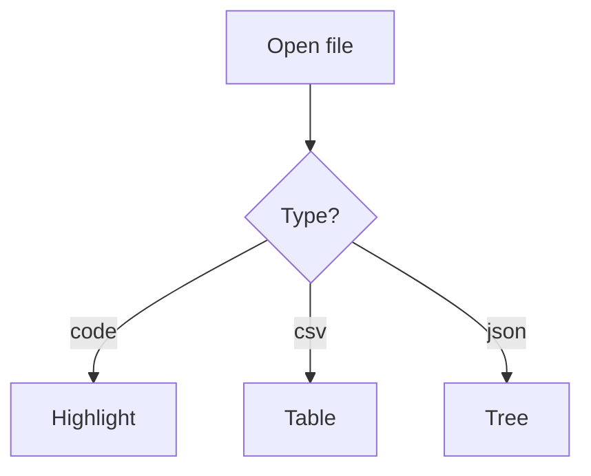
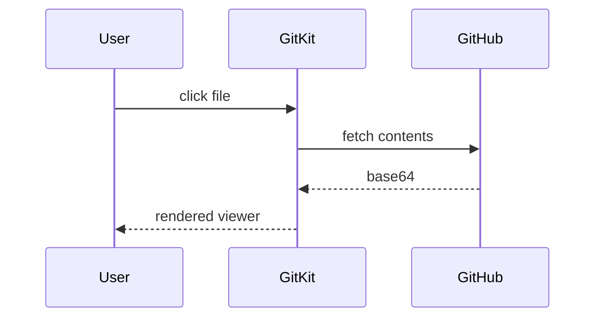

# GitKit Test Repo

Open each file in GitKit to check a feature.

| Folder | Tests |
|---|---|
| `code/` | syntax highlighting + line numbers |
| `html-demo/` | HTML preview (inlined CSS, JS, image) |
| `data/` | CSV / TSV table, JSON / JSONL / GeoJSON tree |
| `media/` | audio and video players |
| `diagrams/` | Mermaid file |
| `notebooks/` | notebook with math + safe HTML output |
| `binary/` | hex viewer |

## Math (KaTeX)

Inline: $E = mc^2$ and $a_1 + b_2 = c_3$.

Prices stay plain text: it costs $5 and $10 today.

Display:

$$\int_0^\infty e^{-x^2}\,dx = \frac{\sqrt{\pi}}{2}$$

```math
\sum_{k=1}^{n} k = \frac{n(n+1)}{2}
```

Code is never treated as math: `$not math$`

## Mermaid in markdown





## Highlighted code block

```python
def greet(name: str) -> str:
    return f"Hello, {name}!"  # simple
```

```javascript
const sum = (a, b) => a + b;
console.log(sum(2, 3));
```

## Broken diagram (should show an error box, not crash)

```mermaid
this is not valid mermaid
```
